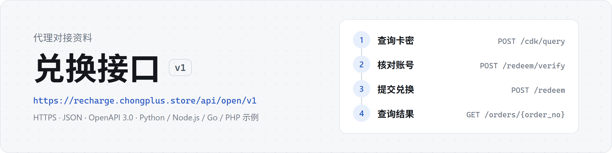

<picture>
  <source media="(prefers-color-scheme: dark)" srcset="assets/banner-dark.png">
  
</picture>

兑换接口供代理的服务器调用，用于查询卡密、核对买家账号、提交兑换和查询订单结果。买家在你自己的页面上操作，不需要访问我们的网站。

[在线文档](https://wtang2217-eng.github.io/agent-api-docs/) · [PDF](代理对接文档.pdf) · [openapi.json](openapi.json) · 示例代码：[Python](examples/redeem.py)、[Node.js](examples/redeem.mjs)、[Go](examples/redeem.go)、[PHP](examples/redeem.php)

以本仓库的最新版本为准。

## 接入信息

| 项目 | 内容 |
| --- | --- |
| 接口地址 | `https://recharge.chongplus.store/api/open/v1` |
| 认证 | `Authorization: Bearer <API 密钥>`，密钥以 `cpa_` 开头，共 47 个字符 |
| 格式 | HTTPS，JSON（UTF-8），只接受服务器之间的调用 |
| 接口描述 | OpenAPI 3.0（`openapi.json`），可以导入 Apifox、Postman |

API 密钥和来源 IP 登记向我们申请。密钥只保存在服务器端，不要提交到任何代码仓库。

请求需要带上自己系统的 `User-Agent`，例如 `my-shop/1.0`。部分语言的默认值（Python 的 urllib、Java 8 等）会被网关拒绝，
返回 HTTP 403 和一行纯文本 `error code: 1010`。

## 验证密钥

```bash
curl https://recharge.chongplus.store/api/open/v1/ping \
  -H "Authorization: Bearer $AGENT_API_KEY" \
  -H "User-Agent: my-shop/1.0"
```

返回 `"ok": true` 时密钥可用，`data.ip` 是接口识别到的来源 IP，登记来源 IP 时以它为准。

## 兑换流程

| 步骤 | 接口 | 说明 |
| --- | --- | --- |
| 1. 查询卡密 | `POST /cdk/query` | 可选，返回套餐和卡密状态，不消耗卡密 |
| 2. 核对账号 | `POST /redeem/verify` | 取得 `ticket`，约需 10 秒 |
| 3. 提交兑换 | `POST /redeem` | 传入 `ticket` 和 `idempotency_key`，取得 `order_no`，卡密开始锁定 |
| 4. 查询结果 | `GET /orders/{order_no}` | 按 `poll_after` 轮询，直到 `succeeded` 或 `failed` |

请求超时或没有收到响应时，用同一个 `idempotency_key` 重发，不会重复兑换。重试规则、状态处理和错误码见在线文档。

## 使用约定

- 本接口只提供兑换能力，买家使用的页面、文案和样式由你自行设计制作。
- 不得复制、仿制或套用我们网站的页面、样式、图片、视频和教程；不得用 iframe 嵌入我们的网站，也不得用自己的域名转发（镜像）我们的网站。
- 失败的订单只能由买家本人发起重试，你的程序不得自动重新提交：每次提交都会实际发起一次付款，同一个账号连续失败时，自动重交只会继续失败。
- 密钥只供你自己的系统使用，不得转借或转卖。
- 订单结果以本接口的返回为准。
- 违反以上任何一条，我们将停用密钥。

## 运行示例

四份示例完成同一件事：查询卡密、核对账号、提交兑换、查询到出结果。只使用语言自带的库（PHP 使用 curl 扩展）。

```bash
export AGENT_API_KEY=cpa_...
python examples/redeem.py <卡密> <买家 Session 文件>
node examples/redeem.mjs <卡密> <买家 Session 文件>
go run examples/redeem.go <卡密> <买家 Session 文件>
php examples/redeem.php <卡密> <买家 Session 文件>
```

## 更新记录

- 2026-10-17：文档改版。调整章节结构，增加接口一览、订单状态图，字段表补充类型和是否必填，示例代码改为分语言切换；PDF 增加书签。接口本身没有变化。
- 2026-10-08：新增 PHP 示例；新增使用约定；说明订单失败后不要让程序自动重新提交。接口本身没有变化。
- 2026-10-05：v1 首版。

接口如有不兼容的变动，我们会提前通知。
